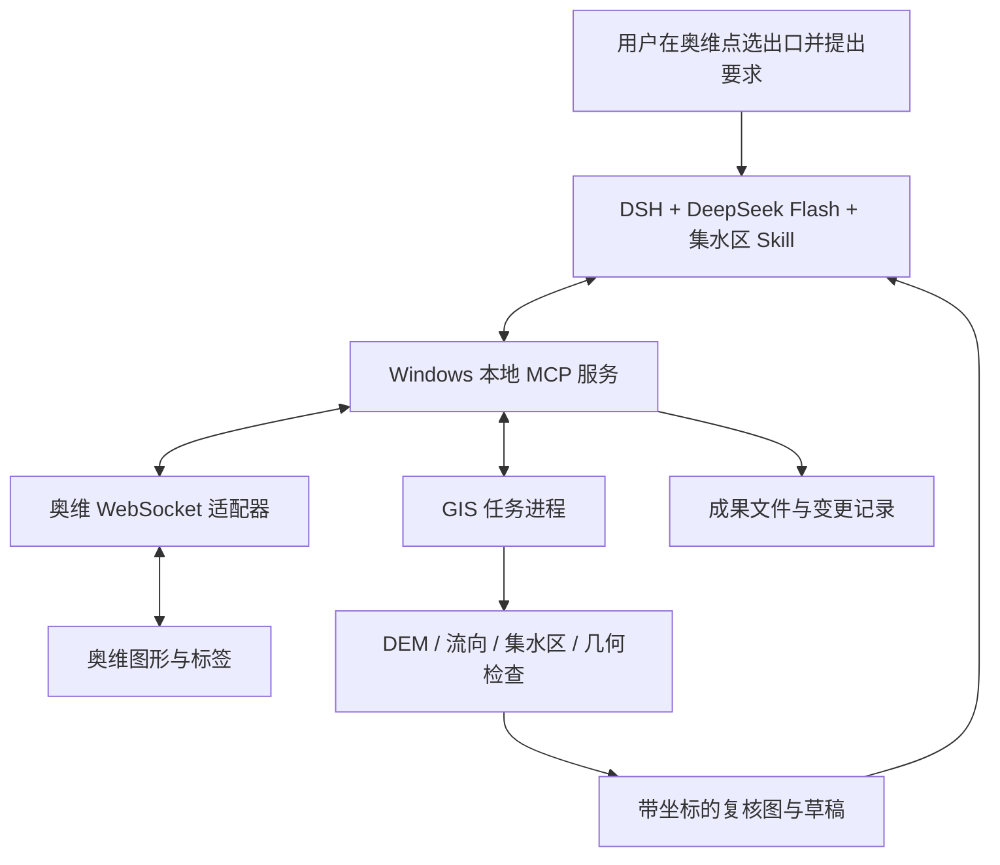

# 奥维集水区精准绘图 MCP + Skill：可行性与实施方案

调研日期：2026-10-29。目标环境：Windows 上的奥维互动地图与 DeepSeek Harness（DSH）。本次交付是调研与设计，不包含已经实现或经过 Windows 联机验收的软件。

## 1. 建议采用的路线

**可行，推荐“本地 MCP + 集水区判读 Skill + 确定性 GIS 计算”，通过奥维官方桌面 WebSocket 接口完成对象读写。**

模型负责理解任务、观察地形、选择工具、识别疑点和提出局部修订；GIS 引擎负责水流方向、集水范围、几何与面积；奥维负责地图展示、对象编辑和成果落图。精度主要取决于地形数据、出口位置和坐标处理，不能靠换大模型保证。

这里的对象是**坝址/取水口以上的地表集水区、汇水区**，不是影像上可见的水面、积水范围或行政范围。分水岭会经过山脊、山峰、鞍部，闭合边界在出口处跨越河道。寻找“最高山顶”本身不能定义正确流域。

产品可以让用户只在奥维上点选出口、说出要求；内部使用 DEM 并不妨碍用户继续使用熟悉的奥维地图。若暂时没有 DEM，可以提供沿等高线辅助描绘的草稿模式，但应明确其判读依据和待复核部位。

## 2. 已核实的可行性与限制

| 能力             | 调研结论                                             | 对设计的影响                        |
| -------------- | ------------------------------------------------ | ----------------------------- |
| 与 Windows 奥维通信 | 官网明确提供 Windows 消息与 WebSocket 两种第三方协作方式           | 首选外部 WebSocket 适配器            |
| 读写地图对象         | 官网列明可读取、添加、修改、删除标签、轨迹、图形、路线、文件夹等                 | 能用坐标和对象 ID 落图，减少屏幕点击误差        |
| 获取图形量算结果       | 官网列明图形对象面积、周长、顶点数量、区域数量                          | 能写后回读并做交叉校验                   |
| 获取地图/等高线       | 官网明确标注相应数据接口需 SVIP                               | 单独探测权限；可改用项目提供的影像、DEM         |
| 官方 OPEN+       | HTML/JavaScript 嵌入式扩展，与第三方桌面 WebSocket 是不同入口     | 第一版不必开发 OPEN+ 插件；后续需要奥维内按钮时再加 |
| DSH 调用 MCP     | 官方客户端支持 stdio 和 Streamable HTTP                  | 使用标准 MCP，不绑定某一种模型 SDK         |
| DSH 使用 Skill   | 官方文件系统 Skill 支持项目内 `.dsh/skills/<name>/SKILL.md` | 固化集水区判读和复核流程                  |
| DSH 接收 MCP 图片  | 官方 MCP 客户端支持，但要求当前模型可接收图片且附件能力已启用                | 必须做真实图片传递验证                   |
| 自动提取集水区        | GRASS GIS 有成熟的流向与指定出口集水区算法                       | 可以构建可重现的确定性计算链                |
| 仅凭截图自动画出工程级边界  | 没有证据可保证                                          | 作为辅助草稿路线，不承诺通用无人审核            |
| 从奥维直接导出原始 DEM  | 本次没有足够官方证据确认                                     | DEM 输入先按独立 GeoTIFF 设计         |

奥维能力来源：[第三方接口](https://www.ovital.com/openapi/)、[OPEN+ 介绍](https://www.ovital.com/135987-2/)、[WebSocket 手册](https://www.gpsov.com/appdoc/index.php?id=32)。DSH 能力来源：[通用 MCP 接入](https://deepseek-harness.github.io/deepseek-harness/en/guide/mcp-memory)、[MCP 客户端](https://github.com/deepseek-ai/deepseek-harness/blob/master/packages/mcp/mcp-client/README.md)、[Skill 文件系统](https://github.com/deepseek-ai/deepseek-harness/blob/master/packages/skill/skill-filesystem/README.md)。

**会员要求已在 WebSocket V2.7 手册进一步确认：地图图片数据、等高线功能需 SVIP 及以上，其他功能至少需要 VIP。**&#x56E0;此第一版可以先用 VIP 做对象读写，并由项目提供本地 DEM；需要从奥维接口取地图/等高线时再考虑 SVIP。第一阶段仍应逐项探测目标账号和版本的权限、点数与数量限制。不能把“数据能在奥维显示”等同于“接口有权批量导出”。手册部分旧错误提示仍写 VIP5，实施时以当前账号与返回结果核验。

## 3. 架构与技术选型



推荐第一版技术栈：

| 部分     | 建议                                              | 原因                   |
| ------ | ----------------------------------------------- | -------------------- |
| MCP 服务 | Python 3.11/3.12 + 官方 MCP Python SDK 中兼容的高层服务接口 | GIS 生态成熟；统一服务和计算语言   |
| 奥维连接   | Python `websockets`，协议单独封装                      | 便于回放、超时、重连和事件处理      |
| 坐标/几何  | `pyproj`、`shapely`                              | 明确坐标变换、几何有效性与面积算法    |
| 栅格 I/O | `rasterio`，固定 GDAL 依赖版本                         | 读取 GeoTIFF、裁剪、投影和掩膜  |
| 水文计算   | 优先选定一个经过样例验证的 GRASS GIS 版本，以独立进程调用              | 有官方算法文档与可重现的参数       |
| 复核图    | 本地渲染 hillshade、等高线、候选边界和出口；可叠加有坐标影像             | 控制地理配准，不依赖模型猜屏幕坐标    |
| 状态/审计  | SQLite 或任务目录 + JSON 元数据                         | 保存任务、参数、草稿版本、改动与回滚信息 |
| 宿主接入   | DSH 通用 MCP 客户端，首版 stdio                         | 少一个常驻 HTTP 服务；便于本机使用 |

版本应在首个可运行样例通过后锁定。Windows 的 GIS 原生依赖是安装风险之一，建议使用固定的 conda-forge 环境或经验证的安装包，不要混用多个来源的 GDAL DLL。模型走云端 API；常规试点不需要本地 GPU。内存和耗时应根据 DEM 实际栅格数量测量，而不是按最终多边形面积估算。

DSH 与奥维适配器尽量都在 Windows 原生环境运行。若用户已有 WSL 工作流，应明确 Windows 进程、WSL、容器各自的 localhost 与路径，避免把 `127.0.0.1` 当作天然互通。

## 4. 核心工作流：先确定流域，再精确写入

### 4.1 确定出口和分析范围

1. 用户在奥维选择坝址/取水口标签，MCP 读取其原始坐标、坐标语义和对象 ID。
2. 同时保存用户指定点和计算采用的河道出口点。只有在合理的搜索半径内，才允许把出口吸附到汇流累积较大的河道栅格。
3. 返回吸附前后位置、距离、河道证据与邻近候选点。距离过大、处于支流交汇处或可能跨越山脊时，保留多个候选供复核，不能默默改点。
4. 用足够覆盖完整上游的 DEM 分析，不以当前屏幕范围或预期面积裁断流域。检测边界截断、外部来水、NoData；必要时扩大分析范围。

### 4.2 生成水文候选边界

建议起步链：DEM 质量检查 → 统一分析投影与分辨率 → 按算法处理空洞和地形问题 → 流向/汇流累积 → 出口吸附 → 指定出口集水区 → 栅格矢量化。

可从 `r.watershed -s` 的 SFD/D8 路线开始，再以 `r.water.outlet` 从该工具生成的流向图中提取出口上游范围。不同软件的 D8 编码可能不同，不能直接混接。

注意：GRASS `r.watershed` 文档说明其最小代价算法不要求预先填洼，但分析区内部 NoData 空洞需要处理。因此不能不分情况执行“填满全部洼地”。若以后换成需要消洼的引擎，按该引擎的要求处理，同时保留真实洼地、湖泊、坝体和涵洞等场景的记录。

简化只能在明确容差内进行；保存原始栅格边界和原始矢量，保护出口、鞍部和关键山脊转折。不能为了看起来圆滑或贴近某个面积而移动分水岭。

算法依据：[r.watershed](https://grass.osgeo.org/grass-stable/manuals/r.watershed.html)、[r.water.outlet](https://grass.osgeo.org/grass-stable/manuals/r.water.outlet.html)。落地时应使用与已安装稳定版本相匹配的文档。

### 4.3 模型像人工一样逐段复核

给模型的材料应包括：全流域概览、带编号的边界分段、局部等高线/阴影地形图、河网、出口、数据覆盖范围和候选边界；每张图都携带范围、投影、像素与地理坐标映射。

对疑点按分段放大，重点检查：

- 是否把山谷当成山脊，是否越过鞍部进入邻近流域。
- 出口是否落在正确河道，是否漏掉关键支流或包含邻近河谷。
- DEM 与影像、等高线是否一致；差异来自配准、植被/建筑、时相，还是实际地形变化。
- 坝体、道路、涵洞、平缓地形或人工引排水是否改变实际汇流。

模型输出“哪一段存在什么疑点、依据是什么、需要什么额外数据或修订约束”，由工具执行局部调整并重新校验。尽量传候选文件 ID、分段 ID、锚点 ID，避免让模型手写几百个顶点。

地形分水岭表示地表自然汇流；地下水、岩溶、跨流域引水、人工排水等可能需要另行定义工程汇水范围。这应是可录入的项目条件，不能靠影像自动推定。

### 4.4 落图与闭环校验

1. 先做几何检查：闭合、有效环、自相交、重复点、异常细长片、多部件与洞。
2. 本地计算面积、周长，并明确水平面积的坐标系和算法。保留原始数据和计算参数。
3. 经奥维适配器写入独立草稿文件夹，设置名称、边界样式、出口标记和必要备注。
4. 从奥维回读对象 ID、顶点及量算结果；同一坐标语义下比较位置与几何。面积差异需先统一投影/椭球、单位和孔洞处理，不能只比显示的小数。
5. 汇报边界依据、疑点与结果。复核后将草稿标为正式成果；修改已有成果时保存原对象快照，支持回滚。

应允许已授权的连续操作直接完成草稿与常规编辑，避免每移动一个顶点就打断用户。对证据不足的关键边界保留待复核状态。

## 5. DEM、等高线与坐标精度

### 数据顺序

1. 优先使用项目实测 DTM、可靠航测/激光雷达成果及已知坐标系统的高程数据。
2. 试点可用 Copernicus GLO-30、SRTM 等公开约 30 米数据验证工作流；小流域、窄山脊、平缓分水岭和工程最终边界可能需要更高质量数据。
3. 等高线可用于独立复核；如果与 DEM 同源，它只能提供另一种显示方式，不能算独立精度证据。

Copernicus 官方将产品定义为 **DSM**，包含建筑物和植被等地表物；GLO-30 为全球约 30 米数据，不能当作裸地实测 DTM。欧洲 EEA-10 的覆盖和授权也不能推广为中国可用的免费 10 米数据。来源：[Copernicus DEM](https://dataspace.copernicus.eu/explore-data/data-collections/copernicus-contributing-missions/collections-description/COP-DEM)。

### 坐标原则

- 为每一数据源记录 CRS、轴顺序、经纬度单位、投影分带和高程基准；不能仅写“GPS 坐标”。
- 内部交换可选择明确的 WGS84 经纬度；距离、吸附、缓冲与面积采用适合项目的米制投影。若要求 CGCS2000，要明确具体投影与分带。
- 奥维地图显示、第三方底图、文件导入与 API 对象坐标可能有不同语义。先按官方协议和控制点实测确定转换，避免重复做 GCJ-02/BD-09 偏移。
- 奥维 V2.7 手册在常用接口中明确把 `CoordType=0` 定义为 CGCS2000 地理坐标，`=1` 为 GCJ-02，`=2` 为当前坐标系；`LatlngType` 则使用另一套取值。图形结构还使用 `Gcj02` 字段。适配器应按命令和结构分别解析，不能把数字 0 一律解释为 WGS84。
- `pyproj` 可承担已知 CRS 的标准变换；互联网底图偏移不应冒充标准 CRS 变换来解决。
- 有坐标的栅格以 geotransform 取点。屏幕截图只用于展示时，不能把像素直接当作经纬度；若必须取点，要先证明当前二维视图映射有效，并处理旋转、缩放、UI 区域和显示缩放。

“坐标能保留很多小数位”“奥维中成功写入”“面积与人工相近”均不能单独证明分水岭正确。

## 6. MCP 工具边界

以下是**建议设计的工具名，不是奥维现有命令名**。原始协议命令只放在适配器内部。

| 工具                                       | 输入/输出要点                               |
| ---------------------------------------- | ------------------------------------- |
| `get_capabilities`                       | 奥维版本、连接状态、对象/地图/等高线权限、点数限制、已实测能力      |
| `get_selection` / `read_object`          | 选择对象或指定 ID；返回坐标、类型、版本摘要               |
| `get_scene`                              | 指定范围与图层；返回地理配准的图片、范围、CRS 和数据来源        |
| `inspect_dem`                            | DEM 文件/数据 ID；返回覆盖、分辨率、NoData、基准和异常    |
| `start_watershed`                        | 原始出口、DEM ID、分析范围与参数；返回持久任务 ID         |
| `get_job` / `cancel_job`                 | 任务状态、阶段、错误与成果 ID；避免 GIS 长任务超过宿主调用超时   |
| `review_segment`                         | 边界分段与证据图；返回局部高程/等高线、河网和相关统计           |
| `revise_candidate`                       | 指定候选、锚点或约束，重新计算或局部编辑并报告影响             |
| `validate_geometry` / `measure_geometry` | 有效性、部件/洞、面积、周长、计算方法                   |
| `write_draft` / `read_back`              | 在草稿文件夹写图，再回读 ID、坐标和量算结果               |
| `finalize_draft` / `rollback_change`     | 标记正式版本或恢复本次保存的快照                      |
| `export_result`                          | GeoJSON、KML、报告；工程投影成果可用 GeoPackage 保存 |

共同约定：返回 `status`、`warnings`、`provenance` 与可追踪 ID。失败不能伪装为空数据或成功。启动 MCP 进程应无地图写入副作用，stdout 只输出协议，日志写 stderr/文件。奥维写入需有幂等键和写后回读；重连后不能盲目重发“创建”导致重复对象。

先核验奥维协议的请求/响应对应方式、异步事件与多边形表示。若命令不带可靠请求关联 ID，首版串行化同类请求，不能直接把它当作通用 JSON-RPC 并发调用。多区域、孔洞、超长对象的表示与限制需实测后再开放。

### 官方协议的实现锚点

下表来自 [WebSocket V2.7 手册](https://www.gpsov.com/appdoc/index.php?id=32)，用于定位适配器实现，不代表本次已联机测试：

| 命令                | 文档能力                | 实施注意                                                      |
| ----------------- | ------------------- | --------------------------------------------------------- |
| `20000`           | 登录                  | 官方示例为预共享密钥 MD5 转大写后取前 16 个字符；成功响应的 `ret` 是版本号，不能把所有非零值当失败 |
| `20104` / `20110` | 读取选中对象基本信息 / 详细树形信息 | 用于从用户选择确定出口或参考边界                                          |
| `20101`           | 获取收藏夹对象             | 请求中明确 `LatlngType`                                        |
| `20112`           | 设置收藏夹对象             | 支持对象树；已有 `ObjID` 会被替换，修改前必须保存快照                           |
| `20103`           | 删除收藏夹对象             | 按本次创建对象和变更记录定位                                            |
| `20802`           | 图形面积、周长、顶点与区域数量     | 手册标注面积为平方米、周长为千米；表格与示例有字段名差异，按官方样例和真实响应适配                 |
| `20301` / `20302` | 地图图片数据 / 图片文件       | 范围与数据返回可用于复核图，但不是原始 DEM                                   |
| `20303`           | 等高线                 | 数据格式与批次仍需实测                                               |
| `20016` / `20730` | 地图角点与中心 / 可显示区域     | 为视图取证与配准提供辅助，不能单靠角点保证任意三维视图的像素映射                          |

手册说明设置入口为“系统 → 系统设置 → 高级 → 第三方接口（窗口消息+Websocket）”，端口可配置，`7699` 只是官方示例。连接使用奥维自身设置的 WS/WSS 服务。文档同时存在部分表格、示例字段和旧会员名称不一致，建议用官方 JS 样例建立协议回放夹具，再以用户安装版本的真实响应验收。

## 7. DSH 接入方式

DSH 官方当前使用 Cordis patch 和 `@deepseek-ai/dsh-mcp-client`，不能直接套用其他客户端的 `mcpServers` 配置。

下面是设计示例，路径、包名及入口要与将来实际实现一致；本仓库当前没有这个 MCP 程序：

```yaml
# ovital.cordis.yml
- insert:
    - id: ovital-mcp
      name: '@deepseek-ai/dsh-mcp-client'
      config:
        serverName: ovital
        transport: stdio
        command: 'C:/work/omap-mcp/.venv/Scripts/python.exe'
        args: ['-m', 'ovital_mcp']
        cwd: 'C:/work/omap-mcp'
        env: {}
        toolCallTimeoutMs: 60000
```

启动示例：`dsh web --patch C:/work/omap-mcp/ovital.cordis.yml`。接入后模型工具会显示为 `mcp__ovital__<tool>`。使用虚拟环境或 conda 环境时，选用其真实 Python 入口与 DLL 环境，不必拘泥于示例 `.venv` 路径。

连接密码由 MCP 从本机配置读取，或按 DSH 当前版本显式传入。DSH 会清理子进程继承环境中的常见凭据变量和 `DSH_*`，所以不能依赖密码变量自动继承。密码不进入工具结果或调试日志。

Skill 放在项目根目录：`.dsh/skills/ovital-watershed/SKILL.md`，包含 `name`、`description` frontmatter。其流程应规定：先读能力与出口 → 检查数据 → 计算候选 → 分段复核 → 写草稿 → 回读 → 汇报与定稿。还应规定无 DEM 的降级策略、疑点记录与禁用“按目标面积凑边界”。

DSH 仍处于开发预览，应记录版本与配置快照。官方参考：[MCP 配置示例与 patch](https://deepseek-harness.github.io/deepseek-harness/en/guide/mcp-memory)、[模型与图片能力设置](https://deepseek-harness.github.io/deepseek-harness/en/guide/providers)、[MCP 客户端配置与图片支持](https://github.com/deepseek-ai/deepseek-harness/blob/master/packages/mcp/mcp-client/README.md)。

## 8. 分阶段实施与验收

### 阶段 A：先证明能精确读写奥维

在用户实际 Windows 版本和账号上运行官方样例，核验连接设置、鉴权与许可。完成点选读坐标、读取已知图形、创建已知多边形、改一个顶点、读回、查询面积周长、删除本次测试对象。


交付：能力矩阵、协议适配器、真实请求/响应脱敏样例、坐标往返结果与失败处理。**此时只能证明能画图，不能宣称已经会判分水岭。**

### 阶段 B：端到端完成一个真实集水区

用用户提供的出口、DEM 与一份审核过的人工边界，跑通计算、复核图、草稿写入、回读和成果导出。用户无需在计算中手工编辑 GIS 命令。

先选一个河道、山脊清楚的样例，再选支流交汇或鞍部不明确的样例。用户提到的“正确/错误”示例应加入验证，但本次粘贴附件并未提供可直接评估的原始图件或边界数据。

### 阶段 C：补齐模型复核与局部修订

Flash 按分段检查；输出疑点证据。工具支持锚点约束、候选重算与局部修订，对每次变更展示影响范围和面积变化。确认模型可看见工具返回的图像。

### 阶段 D：工程化与案例集

补齐重连、重复写防护、任务恢复、大对象、孔洞与多部件、固定依赖环境、Windows 安装说明、Skill、DSH patch、成果报告和回滚。建议形成 5–10 个有独立复核的流域案例，其中保留未用于调参的案例验证泛化。

### 验收必须覆盖四层

| 层次     | 必验事项                             |
| ------ | -------------------------------- |
| 写入精度   | 控制点坐标、轴顺序、度/米单位、重复转换；写前/写后几何往返   |
| 几何正确性  | 闭合、不自相交、多部件/洞处理、无异常碎片            |
| 水文正确性  | 出口河道、主要支流、关键鞍部与分水岭、无分析区截断或邻域错纳   |
| 精度与可追溯 | 与独立人工/测绘参考比较边界距离、重叠率、面积差；保存数据和参数 |

边界偏差应分段统计，可采用 95% 分位距离，并单列最大偏差及关键鞍部。面积相近不代表正确；不能把少纳一个支流和多纳相似面积抵消后判为通过。

具体容差由工程用途、数据精度和试点结果约定。例如“边界多数位于 1–2 个 DEM 栅格内”可以作为算法排查指标，但不等同于工程允许误差，不能由此承诺 30 米数据达到米级精度。面积交叉校验也应在统一计算口径后设阈值。

## 10. 明确不建议作为首版核心的做法

- 单独写一份 Skill，期待模型通过鼠标点击自然获得稳定精度。
- 把一张卫星图交给模型，直接让其输出整圈经纬度。
- 只验证面积接近既有数值，或者优化边界来满足目标面积。
- 把影像水面分割模型当作分水岭提取器。
- 为了复刻人工的转折形状而过度平滑/加点，却不检查水流归属。
- 一开始就开发 OPEN+、多个模型与训练系统，尚未验证一条真实读写链。

## 11. 实施前仍须在 Windows 上核验

1. 用户实际奥维版本、接口启用位置、连接地址与端口、密码派生细节；以当前官方样例为准。
2. 目标账号各接口的会员要求、额度和点数限制。
3. 对象坐标语义、临时/收藏对象区别、形状顶点和区域/洞的确切协议。
4. 地图/等高线接口返回的是何种数据，能否满足复核需要；不能预设等同于 GeoTIFF DEM。
5. DSH 安装版本是否已支持所需图片能力、Skill 与 MCP 配置，是否能在实际模型路由看到图片。
6. 项目出口点、DEM、坐标系统与审核过的参照边界是否齐全。

这些是实施阶段的探测任务，不是要求用户现在逐项补答。它们不影响采用上述架构，但会决定实际精度与交付范围。

## 12. 给 DSH 的任务入口

可将同目录的 `DSH_实施任务书.md` 与本方案一起交给 DeepSeek。要求按阶段完成，每阶段交付可复核证据，先证明真实奥维读写和一个真实流域可用，再扩展自动化能力。不要把 mock、官方文档确认或“工具返回 success”当作最终工程验收。
