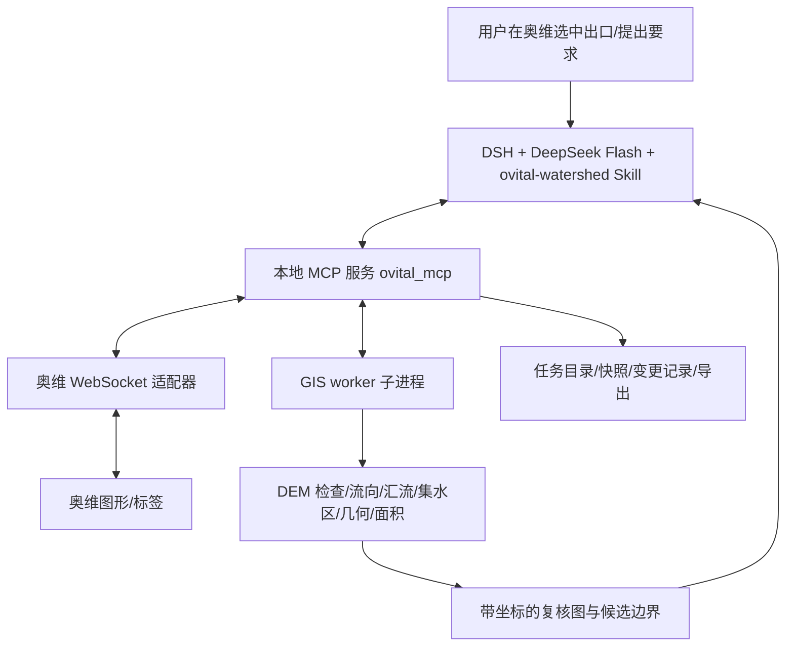

# OMAP Watershed MCP（奥维集水区精准绘图）

本地 MCP 服务 + DSH Skill：在奥维互动地图（Windows 桌面端）中点选坝址/取水口后，用自然语言生成**上游地表集水区（汇水区）**的确定性候选边界，提供带编号分段的影像复核、水平面积量算、草稿落图、写后回读、局部修订与回滚。

> **⚠️ 当前状态（2026-10-30）**
> 本仓库在 **macOS 开发机**上完成了协议适配器、模拟奥维服务器、确定性 GIS 计算链、MCP 工具层、DSH Cordis patch 与 Skill、测试与离线验收证据。
> **Windows 实机已完成**：全量测试（341 passed / 8 skipped，仅 GRASS 缺失）、MCP stdio 24/24、模拟闭环 68/70、DSH patch 组合 9/10，以及奥维 10.7.5 的真实 WebSocket 登录与权限探测（见 [docs/win-test-report.md](docs/win-test-report.md)）。
> 但**真实对象读写仍未成功**（目标账号 `OmapLevel=0`，`20101/20104/20112` 返回 `ret=-5`、`20301/20303` 返回 `ret=-7`），VIP/SVIP 权限、用户 DEM 与经审核参照边界的精度验收也未完成；不得把模拟/离线结果或“能登录”表述为真实工程验收。详见 [docs/offline-acceptance.md](docs/offline-acceptance.md) 与 [docs/待核验清单.md](docs/待核验清单.md)。

## 它做什么 / 不做什么

| 做 | 不做 |
|---|---|
| 从 DEM 计算流向/汇流，按出口提取上游范围，输出闭合边界 | 不把可见水面、洪水淹没线、行政区当作集水区 |
| 生成 hillshade/等高线/河网/编号分段的复核图供模型实际查看 | 不"按目标面积凑边界"，不为了顺滑而移动分水岭 |
| 写入奥维独立草稿文件夹，写后回读坐标与量算 | 不覆盖用户原成果；不在启动时改地图 |
| 报告数据来源、CRS、面积口径、疑点与未验证项 | 不伪造坐标，不承诺 30 m DEM 达到米级精度 |

## 架构



- 模型负责理解、判读、看图复核、提疑点与编排；GIS 引擎负责确定性水文/几何/面积计算；奥维负责展示与对象编辑。
- 长计算走持久 `job_id` + `get_job` 轮询 + `cancel_job`，不依赖一次长同步 MCP 调用。
- 项目依据：[DsH_实施任务书.md](DSH_实施任务书.md)、[OMAP_MCP_可行性与实施方案.md](OMAP_MCP_可行性与实施方案.md)、[docs/architecture.md](docs/architecture.md)。

## 目录

```
ovital_mcp/            MCP 服务与实现
  protocol/            奥维 WebSocket V2.7 适配器（命令 20000/20101/20112/20802/20301...）
  mock/                模拟奥维服务器（故障注入、回放夹具）
  gis/                 DEM 检查、D8/GRASS 集水区引擎、几何/分段/复核图
  tools/               18 个 MCP 工具
  dsh/                 DSH Cordis patch 与配置样例
  config.py coordinates.py store.py jobs.py worker.py server.py
.dsh/skills/ovital-watershed/SKILL.md   项目级 Skill
tests/                 pytest（协议/GIS/存储/任务/MCP/集成）
scripts/               安装、合成 DEM、模拟服务器、验证脚本
docs/                  能力矩阵、协议笔记、安装、验收报告、待核验清单
```

## 快速开始（开发机 / 离线）

```bash
# 1) Python 环境（macOS/Linux 示例；Windows 用 conda 或 venv，见安装文档）
python3 -m venv .venv
.venv/bin/python -m pip install -e ".[test]"

# 2) 配置（复制样例后填写奥维端口与预共享密钥文件路径）
mkdir -p config && cp ovital_mcp/dsh/config.example.yaml config/ovital.yaml

# 3) 跑测试
.venv/bin/python -m pytest -q

# 4) 启动模拟奥维（局部闭环开发，不是真实奥维）
.venv/bin/python scripts/run_mock_ovital.py --psk test-psk

# 5) 启动 MCP（stdio；日志走 stderr）
.venv/bin/python -m ovital_mcp

# 6) 生成合成 DEM（解析真值，用于验证算法）
.venv/bin/python scripts/make_synthetic_dem.py --out .data/synthetic
```

### 接入 DSH

按官方 Cordis patch 方式（不是其他客户端的 `mcpServers` 格式）：

```bash
# Windows 示例
dsh web --patch C:/work/omap-mcp/ovital_mcp/dsh/ovital.cordis.yml
```

接入后工具名为 `mcp__ovital__get_capabilities` 等；Skill 目录 `.dsh/skills/ovital-watershed/SKILL.md`。详见 [ovital_mcp/dsh/README.md](ovital_mcp/dsh/README.md) 与 [docs/install-windows.md](docs/install-windows.md)。

## 工具一览（18 个）

`get_capabilities` · `get_selection` · `read_object` · `get_scene` · `inspect_dem` · `start_watershed` · `get_job` · `cancel_job` · `list_jobs` · `review_segment` · `revise_candidate` · `validate_geometry` · `measure_geometry` · `write_draft` · `read_back` · `finalize_draft` · `rollback_change` · `export_result`

契约见 [docs/architecture.md](docs/architecture.md) §6。

## 质量与安全约束（节选）

1. stdout 只输出 MCP 协议；日志写 stderr/文件。凭据不进入工具返回/日志/任务文件。
2. 启动不连接奥维、不写地图；奥维连接懒建立。
3. 写入带幂等键 + 写前快照 + 写后回读；断线/超时不得盲目重复"创建"。
4. 面积相近、坐标小数位、写入成功都不能单独证明工程精度；必须分段看图复核。
5. 模拟与真实、离线计算与人工审核参考必须分开标识（证据分级见下方）。

## 证据状态

| 等级 | 当前内容 |
|---|---|
| `official_document` | 奥维 WebSocket V2.7 手册的命令/字段/会员要求、GRASS 算法文档、DSH MCP/Skill 文档（见各文档来源链接） |
| `offline_simulated` | 模拟奥维服务器闭环：登录、读对象、写图形、20802 量算、回读、删除回滚 |
| `offline_computed` | 合成解析真值 DEM 的掩膜/面积复算（native 逐像元一致）；GRASS 8.5 与 native D8 引擎计算；真实 SRTM 30 m 地形链路样例；复核图生成 |
| `real_device_pending` | Windows 奥维联机鉴权/权限/坐标轴序/替换语义/面积口径、用户 DEM 与审核边界精度 |

完整证据： [docs/offline-acceptance.md](docs/offline-acceptance.md)、[docs/evidence/README.md](docs/evidence/README.md)；能力矩阵： [docs/capabilities.md](docs/capabilities.md)。

## 文档索引

- [docs/architecture.md](docs/architecture.md) — 接口契约与质量红线
- [docs/capabilities.md](docs/capabilities.md) — 能力矩阵与会员权限
- [docs/protocol-notes.md](docs/protocol-notes.md) — 奥维协议实现依据与待实测项
- [docs/install-windows.md](docs/install-windows.md) — Windows 安装与验收步骤
- [docs/gis-notes.md](docs/gis-notes.md) — DEM/算法/验证数据说明
- [docs/offline-acceptance.md](docs/offline-acceptance.md) — 独立离线验收报告（84/84 checks、349 tests）
- [docs/evidence/README.md](docs/evidence/README.md) — DSH 真实接入/视觉链路本机实测证据（含 transcript 与图样）
- [docs/real-dem-run.md](docs/real-dem-run.md) — 真实公开 DEM（SRTM 30 m）完整链路样例（无独立参考边界，仅链路/合理性证据）
- [docs/verification-findings.md](docs/verification-findings.md) — 独立验证发现的问题与修复复验记录
- [docs/待核验清单.md](docs/待核验清单.md) — 必须在真实环境核验的事项
- [docs/sample-tasks.md](docs/sample-tasks.md) — 示例任务与失败判据

## 许可证与数据

代码为本项目交付物，随附设计文档。DEM 由使用者提供；仓库不包含真实奥维凭据、用户数据或受版权保护的地形数据。
